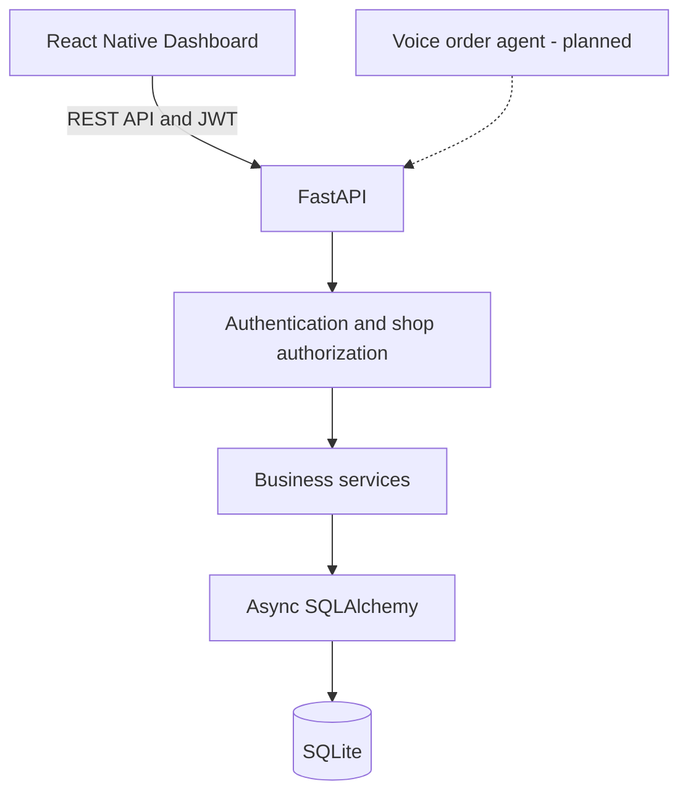
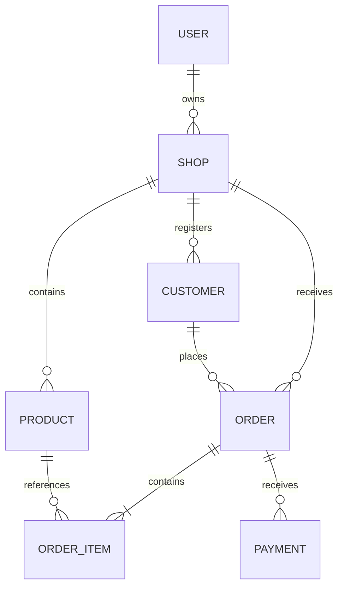
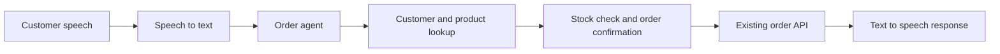

# Gumasta

Gumasta is a shop management application designed for local kirana stores and small retailers. It provides a centralized platform for managing products, inventory, customers, orders, payments and daily business activity.

## Features

- Owner registration and JWT-based authentication
- Multiple shops per owner with shop-level data isolation
- Product management, pricing, stock adjustments and soft deactivation
- Customer registration, search and editing
- Order creation with automatic stock deduction
- Partial and full payment recording with outstanding balance tracking
- Unpaid order cancellation with stock restoration
- Dashboard with sales, received payments, outstanding balances, order history and transaction history
- Date range filtering, customer search and paginated dashboard records

## Technology Stack

| Layer | Technologies |
| --- | --- |
| Backend | Python, FastAPI, Pydantic |
| Database | SQLite, SQLAlchemy 2.0 (async), aiosqlite |
| Migrations | Alembic |
| Authentication | JWT, OAuth2 password flow, Argon2 password hashing |
| Frontend | React Native, Expo, Expo Router, TypeScript |
| Styling | NativeWind, Tailwind CSS |
| API client | Axios |
| Token storage | Expo SecureStore (native) |
| Testing | pytest, pytest-asyncio |

## Architecture



The backend owns business rules and persistence. The frontend communicates through REST APIs and maintains authentication and selected-shop state using React Context.

## Database Design



| Entity | Responsibility |
| --- | --- |
| User | Shop owner account and authentication |
| Shop | Business details and ownership |
| Product | Cost price, selling price, stock, unit and active status |
| Customer | Shop-specific customer contact information |
| Order | Customer purchase, total amount and lifecycle status |
| OrderItem | Product reference, product name snapshot, quantity and actual selling price |
| Payment | Individual payment amount, method and optional reference |

## Business Rules

- Owners can access only their own shops and associated records.
- Orders and stock deductions are performed atomically; insufficient stock is rejected.
- Stock quantities cannot become negative.
- Payments must be positive and cannot exceed the outstanding order balance.
- Partial payments are supported; payment status is derived from recorded payments.
- Only unpaid, completed orders can be cancelled. Cancellation restores stock once.
- Deactivated products are excluded from the default active product list.
- Order lifecycle status (`completed`, `cancelled`) is separate from payment status (`unpaid`, `partially_paid`, `paid`, `cancelled`).
- Historical order items preserve selling prices, but not cost prices; exact historical profit is therefore not available.

## Project Structure

```text
Gumasta/
├── backend/
│   ├── app/
│   │   ├── main.py
│   │   ├── core/
│   │   ├── db/
│   │   ├── models/
│   │   ├── schemas/
│   │   ├── routers/
│   │   ├── services/
│   │   └── dependencies.py
│   ├── alembic/
│   ├── tests/
│   ├── requirements.txt
│   └── .env.example
├── dashboard/
│   ├── src/
│   │   ├── app/
│   │   ├── components/
│   │   ├── contexts/
│   │   ├── services/
│   │   ├── types/
│   │   └── utils/
│   ├── global.css
│   └── package.json
├── voice_agent/             # Upcoming module
└── README.md
```

## Getting Started

### Prerequisites

- Python and pip
- Node.js and npm compatible with the project's Expo SDK
- Git (optional for local development)

### 1. Backend setup (Windows PowerShell)

From the repository root:

```powershell
cd backend
python -m venv .venv
.\.venv\Scripts\Activate.ps1
pip install -r requirements.txt
Copy-Item .env.example .env
```

Configure `backend/.env`:

```dotenv
DATABASE_URL=sqlite+aiosqlite:///./gumasta.db
SECRET_KEY=replace-with-a-long-random-secret
ALGORITHM=HS256
ACCESS_TOKEN_EXPIRE_MINUTES=60
```

Generate a secret with `python -c "import secrets; print(secrets.token_hex(32))"` and use the output as `SECRET_KEY`. Never commit real secrets or local databases.

Apply migrations and start the server:

```powershell
alembic upgrade head
uvicorn app.main:app --host 0.0.0.0 --port 8000 --reload
```

- API documentation: http://localhost:8000/docs
- Health check: http://localhost:8000/health
- Database health check: http://localhost:8000/health/db

### 2. Frontend setup

Open a separate terminal at the repository root:

```powershell
cd dashboard
npm install
```

Create `dashboard/.env`:

```dotenv
EXPO_PUBLIC_API_URL=http://localhost:8000
```

Use the appropriate backend address for your device:

| Environment | Backend URL |
| --- | --- |
| Web on development computer | `http://localhost:8000` |
| Android emulator | `http://10.0.2.2:8000` |
| Physical device on same network | `http://<computer-LAN-IP>:8000` |

For browser access, ensure the backend CORS configuration permits the frontend's actual origin. For physical devices, allow the development server through the local firewall as needed.

```powershell
npx expo start --clear
```

Register an owner account through the application, create a shop and select it to begin. No seeded login credentials are assumed.

## API Reference

Protected endpoints require `Authorization: Bearer <access_token>`.

### Authentication and shops

| Method | Endpoint | Description |
| --- | --- | --- |
| POST | `/auth/register` | Register owner |
| POST | `/auth/login` | Obtain access token (form-encoded username=email and password) |
| GET | `/auth/me` | Current owner |
| POST | `/shops` | Create shop |
| GET | `/shops` | List owned shops |
| GET | `/shops/{shop_id}` | Shop details |
| PATCH | `/shops/{shop_id}` | Update shop |

The following endpoints are relative to `/shops/{shop_id}`.

| Method | Endpoint | Description |
| --- | --- | --- |
| GET, POST | `/products` | List or create products |
| GET, PATCH, DELETE | `/products/{product_id}` | Read, update or deactivate product |
| PATCH | `/products/{product_id}/stock` | Relative stock adjustment |
| GET, POST | `/customers` | List, search or create customers |
| GET, PATCH | `/customers/{customer_id}` | Read or update customer |
| GET, POST | `/orders` | List or create orders |
| GET | `/orders/{order_id}` | Order details and items |
| POST | `/orders/{order_id}/cancel` | Cancel unpaid order |
| GET, POST | `/orders/{order_id}/payments` | List or record payments |
| GET | `/orders/{order_id}/payment-summary` | Paid amount, due amount and payment status |
| GET | `/dashboard/summary` | Business summary |
| GET | `/dashboard/orders` | Filtered order history |
| GET | `/dashboard/transactions` | Filtered payment history |

### Example order request

```json
{
  "customer_id": "<customer-uuid>",
  "order_items": [
    {"product_id": "<product-uuid>", "quantity": 2}
  ]
}
```

An optional `unit_price` can override the current selling price in the backend API. The current frontend uses the product selling price.

### Example payment request

```json
{
  "amount": "65.00",
  "payment_method": "cash",
  "reference": null
}
```

Supported methods: `cash`, `upi`, `card`, `bank_transfer`. These record payments; they do not initiate payment gateway transactions.

## Dashboard Metrics

| Metric | Meaning |
| --- | --- |
| Total sales | Value of completed orders created within the selected date range |
| Amount received | Payments recorded within the selected date range, including payments for older orders |
| Outstanding | All-time unpaid balance across completed orders |
| Total orders | Number of completed orders created within the selected date range |

Dashboard dates default to today in Indian Standard Time (IST). Customer search filters order and transaction lists, not summary totals. Transactions currently represent incoming payments only.

## Testing

From `backend/`, with its virtual environment active:

```powershell
python -m pytest -v
```

The backend test suite covers authentication, ownership, product and customer operations, orders, payments, dashboard filtering and concurrency scenarios such as overselling, overpayment and competing cancellation requests.

### Manual end-to-end demo

1. Register an owner and create a shop.
2. Add Rice (selling price ₹65, stock 50) and Sugar (selling price ₹45, stock 30).
3. Register a customer.
4. Create an order for two units of Rice and one unit of Sugar (₹175).
5. Verify stock decreases to 48 and 29 respectively.
6. Record a ₹100 payment and verify ₹75 remains outstanding.
7. Record the remaining ₹75 and verify the order is marked paid.
8. Create a separate unpaid order, cancel it and verify stock restoration.
9. Check dashboard totals, transaction history and shop isolation.

## Current Limitations

- Local-development prototype; production deployment and security hardening are not included.
- Integer stock quantities only.
- No supplier management, outgoing transactions, refunds or payment gateway integration.
- No offline synchronization or advanced analytics.
- Selected shop is held in memory and may need to be selected again after restart.
- Order and payment creation do not yet support idempotency keys; verify history before retrying ambiguous network failures.
- Dashboard implementation and full regression suite should be verified locally before release.

## Roadmap: Voice Order Agent

The next module will allow customers to place orders through a voice conversation. It is planned as a separate service that reuses the existing Gumasta APIs rather than writing directly to the database.



Planned capabilities:

- Identify customers by mobile number and collect details for new customers.
- Resolve spoken product names against the shop catalog.
- Validate quantities, availability and pricing using backend data.
- Request explicit confirmation before creating an order.
- Create customer records when needed and place unpaid orders visible in the dashboard.
- Use server-side authorization scoped to the configured shop.

Proposed stack: Faster Whisper, Groq, LangGraph, Edge TTS and a minimal push-to-talk web interface. Telephone integration and real-time streaming are deferred.

## Project Status

The core backend and owner-facing frontend have been developed incrementally. Authentication, shop selection and core order/payment interactions have been exercised during development. The final dashboard and complete regression suite require local verification. The voice agent is not yet implemented.
